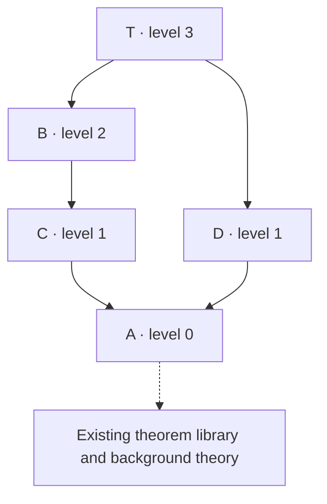

# From Proof Production to Knowledge Assimilation

### A Paradigm of Hierarchical Proofs and Cumulative Verification for Mathematics in the Age of AI

**Chunming LAI (赖俊铭)** · Independent Researcher  
[ORCID: 0009-0002-7594-4535](https://orcid.org/0009-0002-7594-4535) · [Contact](mailto:jimmybus0610@outlook.com)

> A proposal to turn the growing capacity for machine-generated proofs into cumulative, human-understandable mathematical knowledge.

[中文研究主页](README.zh-CN.md) · [How to build](BUILD.md) · [Academic discussion](https://github.com/jimmyMSTon/hierarchical-mathematics/discussions)

## Read the paper

| Language | Manuscript | Reproducible source |
| --- | --- | --- |
| English (primary) | [PDF](paper/Paradigm_EN.pdf) | [LaTeX](source/Paradigm_EN.tex) |
| 中文 | [PDF](paper/Paradigm_ZH.pdf) | [LaTeX](source/Paradigm_ZH.tex) |

Version **1.0.1** (technical maintenance; manuscript dated 24 November 2026) · [Latest release](https://github.com/jimmyMSTon/hierarchical-mathematics/releases/tag/v1.0.1) · [Original publication v1.0.0](https://github.com/jimmyMSTon/hierarchical-mathematics/releases/tag/v1.0.0)

## The challenge

AI may dramatically expand the production of mathematical proofs. Mathematical progress, however, requires more than correct conclusions: it requires the human understanding, verification, communication and reuse of mathematical knowledge.

This initiative advocates a shift in research and publication practices, from the complete paper as the predominant unit of acceptance toward a network of locally examinable, independently reusable proof contributions.

## The proposed paradigm

Given a target theorem $T=\mathrm{thm}$, organize its new proof contributions into a finite directed acyclic dependency graph. For each node $v$, let $D(v)$ be its direct new dependencies relative to an existing theorem library.

$$
\ell(v)=\begin{cases}
0,& D(v)=\varnothing,\\
1+\max_{u\in D(v)}\ell(u),& D(v)\ne\varnothing.
\end{cases}
$$

The target's level is $r=\ell(T)$. Dependencies may cross levels; branches need not have equal depths, and several results may reuse the same lemma.

*Illustrative dependency graph from the framework. Arrows denote references; mathematical establishment proceeds in the opposite direction.*

Human mathematicians can examine and verify local proofs from foundational results upward, add established contributions to shared theorem libraries, and reuse them in higher-level proofs and subsequent investigations. The objective is individually manageable arguments, not an arbitrary limit on proof length.

If the local derivations are valid in a common background theory $\Sigma_0$,

$$
\Sigma_0\cup\{P_u:u\in D(v)\}\vdash P_v,
$$

their composition establishes $\Sigma_0\vdash P_T$. The paper also gives a cumulative verification model and explains why the accumulation of established results is logically conservative.

The framework distinguishes formal correctness, semantic fidelity and mathematical understanding. Practical improvements in review efficiency, distributed verification and long-term reuse are potential benefits, not experimentally established outcomes.

## A call to the mathematical community

We invite mathematicians, research institutions, journals, formalization communities and AI research groups to explore how existing tools and institutions can support hierarchical proof organization, local human understanding and cumulative acceptance of mathematical knowledge.

The aim is not to replace mathematical papers or claim to invent theorem libraries or proof assistants. It is to make the absorption of mathematical knowledge a central organizing principle of research in the age of AI.

## Citation

Lai, Chunming (2026). *From Proof Production to Knowledge Assimilation: A Paradigm of Hierarchical Proofs and Cumulative Verification for Mathematics in the Age of AI*. Position paper, version 1.0.1 (technical maintenance of v1.0.0).

See [CITATION.cff](CITATION.cff) and [BibTeX](CITATION.bib) for citation metadata. The DOI and arXiv identifier are not yet assigned.

## Access and reproducibility

The English PDF is unchanged from v1.0.0. Version 1.0.1 embeds missing Chinese Unicode maps without changing the Chinese PDF page appearance or manuscript content. See [BUILD.md](BUILD.md) for compilation and the post-processing command, [SHA256SUMS](SHA256SUMS) for file verification, and [REFERENCES.md](REFERENCES.md) for open-access alternatives. Both manuscripts have selectable text; the PDFs are not certified PDF/UA tagged documents.

## Research status and AI disclosure

This is a research and publication paradigm proposal, not a claim of independent peer review, formal verification of the manuscript, or established historical priority. The central concept and choice of bottom-up dependency height were supplied or confirmed by the author; ChatGPT assisted with formalization, analysis, literature research, examples, drafting and revision, as disclosed in the manuscript.

The English source builds with pdfLaTeX, and the Chinese source with XeLaTeX followed by the documented Unicode-map repair. The manuscripts and their sources are licensed under [CC BY 4.0](https://creativecommons.org/licenses/by/4.0/). See [LICENSE](LICENSE).
